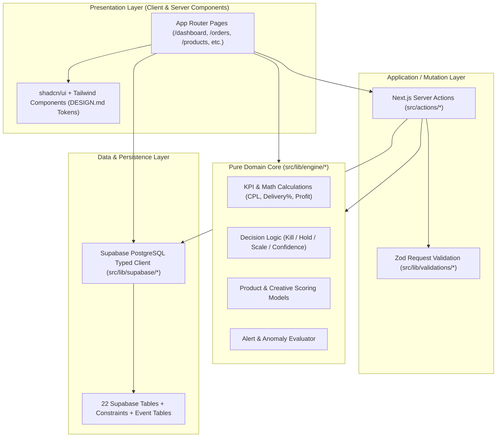
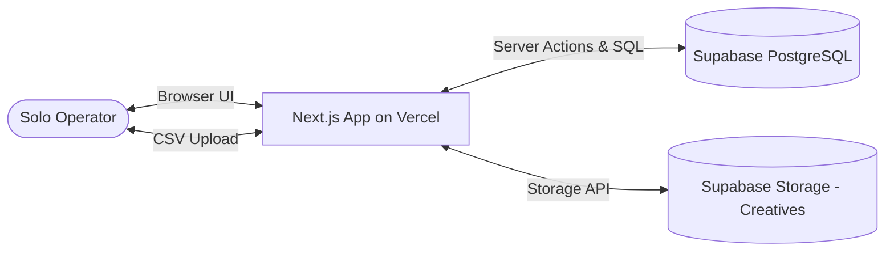
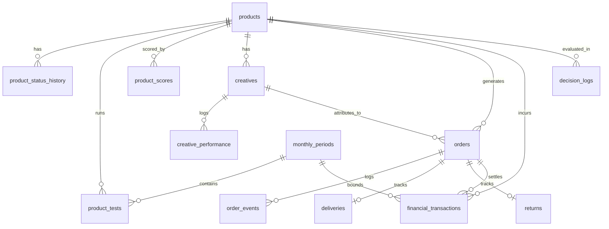

---
name: COD Growth OS
type: architecture-spine
purpose: build-substrate
altitude: system
paradigm: Layered Clean Core (Hexagonal Domain Core + Server Actions + Supabase)
scope: Full-stack web application for single-operator Tunisia COD e-commerce management
status: final
created: 2026-08-18
updated: 2026-08-18
binds:
  - FR-1..FR-46
  - UJ-1..UJ-4
  - DESIGN.md
  - EXPERIENCE.md
sources:
  - {project-root}/COD E-commerce Growth OS — Product Requirements Document.md
  - {planning_artifacts}/ux-designs/ux-cod-system-2026-08-18/DESIGN.md
  - {planning_artifacts}/ux-designs/ux-cod-system-2026-08-18/EXPERIENCE.md
companions: []
---

# Architecture Spine — COD Growth OS

## 1. Design Paradigm

The system follows a **Layered Clean Core (Hexagonal Domain Core)** pattern:



### Layer Namespace Mapping
- `src/lib/engine/`: Pure, synchronous, side-effect-free TypeScript math, formulas, and decision engines. **Zero external DB/network dependencies**.
- `src/lib/supabase/`: Supabase database clients (Server client for Server Actions/RSC, Browser client for real-time/uploads).
- `src/lib/validations/`: Zod schemas for all domain entities, CSV import rows, and action payloads.
- `src/actions/`: Next.js Server Actions handling mutations, atomic event logging, and route revalidation.
- `src/components/`: Reusable, typed UI components adhering strictly to `DESIGN.md` tokens (tabular numbers, solid slate surfaces, semantic badges).
- `src/app/`: Next.js 15 App Router page routes mapping to the 10 top-level PRD surfaces.

---

## 2. Invariants & Rules

### AD-1 — Pure TypeScript Calculation & Decision Core [ADOPTED]
- **Binds:** `FR-1`, `FR-10`, `FR-12`, `FR-13`, `FR-14`, `FR-15`, `FR-18`, `FR-23`, `FR-30`, `FR-34`, `FR-44`, `FR-45`, `§6`
- **Prevents:** Formula drift, duplicate KPI math across Dashboard, Products, Finance, and Monthly Review, and divergent decision logic.
- **Rule:** All KPI equations, profit calculations, product scores, creative rankings, and decision recommendations must be pure TypeScript functions in `src/lib/engine/`. UI components must never compute KPIs directly from raw attributes.

### AD-2 — Single-Operator Data Model without In-App Auth [ADOPTED]
- **Binds:** `§8.1`, `§8.3`, `FR-31`
- **Prevents:** Multi-tenant complexity, unnecessary `user_id` / `org_id` column pollution, session overhead.
- **Rule:** The database schema has no `users`, `tenants`, or `roles` tables. Database access runs via environment variable connection. Server actions use the Supabase server client. Deployment-level protection (e.g. Vercel basic auth or IP allowlist) operates outside app code.

### AD-3 — Immutable Event & Audit Logging for Mutations [ADOPTED]
- **Binds:** `FR-11`, `FR-17`, `FR-27`, `FR-31`, `§8.2`
- **Prevents:** Silent state overwrites and untracked history of product status changes, decision overrides, and COD order outcomes.
- **Rule:** Every product status change inserts a record into `product_status_history`; every decision accept/override inserts into `decision_logs`; every order status transition inserts into `order_events`. Historical event tables are append-only.

### AD-4 — Optimistic Server Action Mutations for Fast Triage [ADOPTED]
- **Binds:** `FR-6`, `FR-26`, `FR-27`, `FR-31`, `UJ-3`
- **Prevents:** UI latency during high-speed daily operations (e.g. confirming 10 orders or updating delivery statuses in minutes).
- **Rule:** All database writes execute through Next.js Server Actions validated with Zod. Frontend order and product tables use React `useOptimistic` or React Query optimistic cache mutations for instantaneous UI feedback.

### AD-5 — Client-Side Pre-Validation for CSV Ad Import [ADOPTED]
- **Binds:** `FR-25`
- **Prevents:** Corrupted rows, malformed Meta Ads exports breaking database calculations.
- **Rule:** CSV parsing is performed in-browser via PapaParse. A Zod schema validates required columns (`date`, `campaign_name`, `ad_set_name`, `ad_name`, `spend`, `impressions`, `clicks`, `leads`). The user confirms the preview before a batched Server Action upsert writes to `ad_performance`.

### AD-6 — Exact Currency & Division-by-Zero Protection [ADOPTED]
- **Binds:** `FR-1`, `FR-6`, `FR-10`, `FR-31`, `§6`
- **Prevents:** JavaScript floating-point errors on currency and runtime `NaN` / `Infinity` display.
- **Rule:** Currency is stored in PostgreSQL as `numeric(12, 3)` (Tunisian Dinar standard `0.000 DT`). All division operations must use `safeDivide(numerator, denominator, fallback = null)`. A null result is rendered in the UI as an em-dash (`—`).

### AD-7 — Financial Transactions as Single Source of Cash Truth [ADOPTED]
- **Binds:** `FR-31`, `FR-32`, `FR-33`, `FR-34`
- **Prevents:** Inconsistencies between operating cash balance, profit vault, and ad spend records.
- **Rule:** `financial_transactions` is the single source of truth for all cash flows. Cash bucket balances (`Advertising Capital`, `Operations Capital`, `Profit Vault`) are computed by aggregating transactions grouped by bucket.

### AD-8 — Centralized Alert & Decision Evaluation [ADOPTED]
- **Binds:** `FR-4`, `FR-13`, `FR-16`, `FR-45`, `FR-46`
- **Prevents:** Fragmented alert conditions and inconsistent threshold triggers.
- **Rule:** All alerts (CPL spike, delivery rate drop, cash buffer warning) and Kill/Hold/Scale recommendations are evaluated deterministically in `src/lib/engine/decision.ts` and `src/lib/engine/alerts.ts` using thresholds stored in `app_settings`.

---

## 3. Consistency Conventions

| Concern | Convention |
|---|---|
| **Naming** | DB tables & columns: `snake_case`. TypeScript types/interfaces: `PascalCase`. Files: `kebab-case.ts(x)`. Server actions: `camelCaseAction`. |
| **Data & Formats** | Currency: `numeric(12, 3)` (DT). Dates: ISO 8601 UTC strings (`YYYY-MM-DDTHH:mm:ssZ`) in DB, formatted with `date-fns` for UI. IDs: UUID v4 (`gen_random_uuid()`). |
| **Error Handling** | Server actions return `{ success: true, data }` or `{ success: false, error: string, validationErrors?: Record<string, string[]> }`. No unhandled promise rejections. |
| **State & Mutation** | Server Components for initial data fetches; Server Actions for mutations; React hooks (`useOptimistic` / React Query) for responsive local UI state. |
| **Styling Tokens** | Strictly use tokens defined in `DESIGN.md` (no custom ad-hoc hex colors, no gradient overlays, tabular numbers for all numeric data). |

---

## 4. Stack

| Technology | Version | Purpose |
|---|---|---|
| **Next.js** | `15.x` (App Router) | Full-stack web framework & Server Actions |
| **React** | `19.x` | UI runtime & Server Components |
| **TypeScript** | `5.x` | End-to-end type safety |
| **Supabase (PostgreSQL)** | `PostgreSQL 15+` | Relational database, constraints, and storage |
| **Tailwind CSS** | `3.4.x / 4.x` | Utility-first styling engine |
| **shadcn/ui** | `latest` | High-quality accessible component primitives |
| **Zod** | `3.x` | Schema definition & mutation validation |
| **Lucide React** | `latest` | Consistent, clean iconography |
| **PapaParse** | `5.x` | Fast client-side CSV parsing for Meta Ads imports |
| **date-fns** | `3.x` | Date math and Tunisian timezone formatting |

---

## 5. Structural Seed

### 5.1 System Boundary & Context



### 5.2 Core Entity Relationship Diagram (ERD)



### 5.3 Minimal Source Tree

```text
COD system/
├── src/
│   ├── app/                               # Next.js 15 App Router
│   │   ├── layout.tsx                     # Root layout (Sidebar + Theme provider)
│   │   ├── page.tsx                       # Dashboard & Action Center (FR-1..5)
│   │   ├── products/                      # Products & Economics (FR-6..12)
│   │   ├── testing/                       # Test manager (FR-9..10)
│   │   ├── creatives/                     # Creative cards & hooks (FR-19..24)
│   │   ├── orders/                        # COD Operations pipeline (FR-26..30)
│   │   ├── finance/                       # Cash buckets & ledger (FR-31..35)
│   │   ├── analytics/                     # Aggregated trends (FR-30, §6)
│   │   ├── research/                      # Research intake (FR-7..8)
│   │   ├── monthly-review/                # Month-end close & plan (FR-36..41)
│   │   └── settings/                      # Configurable thresholds (FR-15, §1)
│   ├── actions/                           # Server Actions (Mutations)
│   │   ├── products.ts
│   │   ├── orders.ts
│   │   ├── creatives.ts
│   │   ├── finance.ts
│   │   ├── decisions.ts
│   │   └── import-ads.ts
│   ├── lib/
│   │   ├── engine/                        # Pure Domain Engine Core (AD-1)
│   │   │   ├── calculations.ts            # Safe KPI formulas (CPL, Rates, Profit)
│   │   │   ├── decision.ts                # Kill / Hold / Scale evaluator
│   │   │   ├── scoring.ts                 # Product & Creative scores (0–100)
│   │   │   └── alerts.ts                  # Cash, CPL, Delivery anomaly rules
│   │   ├── supabase/                      # Supabase client setup (AD-2)
│   │   │   ├── server.ts
│   │   │   ├── client.ts
│   │   │   └── database.types.ts
│   │   ├── validations/                   # Zod schemas (AD-4, AD-5)
│   │   └── utils.ts
│   └── components/                        # UI Components (DESIGN.md)
│       ├── ui/                            # shadcn primitives
│       ├── dashboard/                     # Scoreboard, Checklist, Action Cards
│       ├── orders/                        # Fast-edit COD table, status pill
│       └── shared/                        # StatCard, DecisionPill, Currency
├── supabase/
│   └── migrations/                        # PostgreSQL schema migrations
│       └── 00001_initial_schema.sql
├── public/
├── package.json
├── tsconfig.json
└── tailwind.config.ts
```

---

## 6. Capability → Architecture Map

| Capability / Area | PRD Binds | Lives in | Governed by |
|---|---|---|---|
| **Dashboard & Scoreboard** | `FR-1`–`FR-5` | `src/app/page.tsx`, `src/components/dashboard/` | `AD-1`, `AD-8`, `DESIGN.md` |
| **Product Lifecycle & Scoring** | `FR-6`–`FR-12` | `src/app/products/`, `src/lib/engine/scoring.ts` | `AD-1`, `AD-3` |
| **Decision Engine & Overrides** | `FR-13`–`FR-18` | `src/lib/engine/decision.ts`, `src/actions/decisions.ts` | `AD-1`, `AD-3`, `AD-8` |
| **Creative Library & Recommendations** | `FR-19`–`FR-24` | `src/app/creatives/`, `src/lib/engine/scoring.ts` | `AD-1`, `AD-8` |
| **CSV Ad Performance Import** | `FR-25` | `src/actions/import-ads.ts`, `src/lib/validations/` | `AD-5` |
| **COD Order Pipeline & Follow-ups** | `FR-26`–`FR-30` | `src/app/orders/`, `src/actions/orders.ts` | `AD-3`, `AD-4`, `EXPERIENCE.md` |
| **Finance & Cash Buckets** | `FR-31`–`FR-35` | `src/app/finance/`, `src/actions/finance.ts` | `AD-6`, `AD-7` |
| **Monthly Review & Next-Month Draft** | `FR-36`–`FR-41` | `src/app/monthly-review/`, `src/lib/engine/` | `AD-1`, `AD-6` |
| **Scale Planning & Alert Dispatch** | `FR-42`–`FR-46` | `src/lib/engine/alerts.ts`, `src/app/page.tsx` | `AD-1`, `AD-8` |

---

## 7. Deferred Items

| Decision | Reason it can wait |
|---|---|
| **Courier API Synchronization** | Out of scope for v1 (PRD §3.2); manual CSV / status update is reliable. |
| **Meta Ads Graph API Integration** | Out of scope for v1 (PRD §3.2); CSV import covers performance tracking. |
| **Automated WhatsApp Bot / Calling** | Out of scope for v1 (PRD §3.2); 1-click WhatsApp links (`wa.me`) provide sufficient speed. |
| **Multi-operator / Multi-tenant DB isolation** | Strictly single-operator system in v1 (PRD §8.1). |
