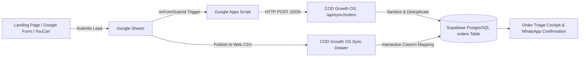

# Google Sheets Real-Time Integration Guide — COD Growth OS

This document provides complete, production-ready technical instructions for integrating Google Sheets with **COD Growth OS** for real-time customer order lead synchronization, automatic Tunisian phone sanitization, governorate normalization, and idempotent de-duplication.

---

## Architecture Overview



---

## Method 1: Real-Time Webhook via Google Apps Script (Recommended)

This method automatically pushes leads to your COD Growth OS instance the exact second a customer submits an order on your landing page or Google Form.

### Step 1: Open Apps Script in your Google Sheet
1. Open your Google Sheet containing incoming orders.
2. In the top menu, click **Extensions** &gt; **Apps Script**.

### Step 2: Paste the Integration Script
Replace all contents in the `Code.gs` editor with the following script:

```javascript
/**
 * COD Growth OS — Real-Time Lead Sync Trigger
 * Automatically posts new order submissions to COD Growth OS
 */

// REPLACE with your deployed application domain (e.g., https://your-domain.vercel.app or http://localhost:3000)
const COD_SYSTEM_URL = "https://your-domain.vercel.app/api/sync/orders";

// OPTIONAL: Default Product ID if not present in the sheet
const DEFAULT_PRODUCT_ID = "prod-1";

/**
 * Triggered on Google Form submission or landing page webhook injection
 */
function onFormSubmit(e) {
  try {
    var values = e.namedValues || {};
    
    // Auto-detect fields from diverse column names (English, French, Arabic/Derja)
    var customerName = getField(values, ["Full Name", "Customer Name", "Nom", "Nom et Prenom", "الاسم", "Name"]);
    var phone = getField(values, ["Phone", "Phone Number", "Telephone", "Numéro", "Téléphone", "الهاتف", "Tel"]);
    var governorate = getField(values, ["Governorate", "Ville", "Gouvernorat", "City", "الولاية", "State"]);
    var address = getField(values, ["Address", "Adresse", "Street", "العنوان", "Rue"]);
    var quantity = parseInt(getField(values, ["Quantity", "Quantité", "الكمية", "Qty"]) || "1", 10);
    var unitPrice = parseFloat(getField(values, ["Price", "Prix", "Unit Price", "السعر"]) || "49.0");
    var source = getField(values, ["Source", "UTM Source", "Campaign", "Page"]) || "Google Sheets Webhook";
    var notes = getField(values, ["Notes", "Remarque", "Comment", "ملاحظات"]) || "";

    var payload = {
      customer_name: customerName,
      phone: phone,
      governorate: governorate || "Tunis",
      address: address || "Centre Ville",
      product_id: DEFAULT_PRODUCT_ID,
      quantity: isNaN(quantity) ? 1 : quantity,
      unit_price: isNaN(unitPrice) ? 49.0 : unitPrice,
      source: source,
      notes: notes ? "[Sheets Webhook] " + notes : "Auto-synced via Google Apps Script"
    };

    var options = {
      method: "post",
      contentType: "application/json",
      payload: JSON.stringify(payload),
      muteHttpExceptions: true
    };

    var response = UrlFetchApp.fetch(COD_SYSTEM_URL, options);
    Logger.log("Sync Response: " + response.getContentText());
  } catch (error) {
    Logger.log("Sync Error: " + error.toString());
  }
}

/**
 * Helper to extract value by multiple possible header aliases
 */
function getField(namedValues, aliases) {
  for (var i = 0; i < aliases.length; i++) {
    var key = aliases[i];
    if (namedValues[key] && namedValues[key].length > 0 && namedValues[key][0] !== "") {
      return namedValues[key][0].trim();
    }
  }
  return "";
}
```

### Step 3: Configure the Trigger
1. In the Apps Script sidebar, click the **Triggers** icon (looks like an alarm clock ⏰).
2. Click **+ Add Trigger** (bottom right).
3. Set the following options:
   - **Choose which function to run:** `onFormSubmit`
   - **Choose which deployment should run:** `Head`
   - **Select event source:** `From spreadsheet`
   - **Select event type:** `On form submit` (or `On change` if leads are injected by Zapier / Make / Webhooks)
4. Click **Save** and grant the required permissions (`Allow UrlFetchApp`).

---

## Method 2: Published Google Sheet URL (1-Click Pull)

If you prefer pulling data on demand or do not want to install scripts:

### Step 1: Publish your Sheet as CSV
1. In your Google Sheet, click **File** &gt; **Share** &gt; **Publish to web**.
2. Under **Link**, choose your specific tab (e.g., `Sheet1` or `Orders`) instead of "Entire Document".
3. Under format, select **Comma-separated values (.csv)**.
4. Click **Publish** and copy the generated link (e.g., `https://docs.google.com/spreadsheets/d/e/2PACX-1v.../pub?gid=0&single=true&output=csv`).

### Step 2: Sync in COD Growth OS
1. Navigate to `/orders` in **COD Growth OS**.
2. Click the **Sync Google Sheet** button in the top action bar.
3. Click the **Published Sheet URL** tab.
4. Paste your published URL and click **Fetch Sheet**.
5. Map your sheet's column names to:
   - Customer Name
   - Phone Number
   - Governorate
   - Address
6. Click **Ingest Orders**. The system will automatically skip duplicate leads that have already been imported!

---

## Method 3: Direct Spreadsheet Copy-Paste (Fastest for Batch Imports)

1. Highlight your rows in Google Sheets or Excel (including header row).
2. Press `Ctrl + C` (or `Cmd + C`).
3. In COD Growth OS, click **Sync Google Sheet** on `/orders`.
4. Under the **Paste / CSV Input** tab, press `Ctrl + V` into the text area.
5. The system will instantly detect columns, normalize Tunisian phone numbers, and display a live preview with:
   - 🟢 **NEW LEAD**: Ready to import
   - 🟡 **DUPLICATE**: Order already exists for this phone & product (auto-skipped)
   - 🔴 **INVALID**: Malformed phone or missing name (shows tooltip error)
6. Click **Ingest X Orders** to import directly into the triage table.

---

## Webhook API Reference: `POST /api/sync/orders`

You can also push orders from custom landing pages, Shopify webhooks, or YouCan apps directly to:

- **Endpoint:** `POST /api/sync/orders`
- **Content-Type:** `application/json`

### Request Body (Single Order)
```json
{
  "customer_name": "Yassine Ben Amor",
  "phone": "+216 22 345 678",
  "governorate": "Tunis",
  "address": "15 Avenue Habib Bourguiba, Centre Ville",
  "product_id": "prod-1",
  "quantity": 1,
  "unit_price": 49.000,
  "delivery_fee": 7.000,
  "source": "YouCan Landing Page",
  "notes": "Prefers afternoon delivery"
}
```

### Request Body (Batch Orders)
```json
[
  {
    "customer_name": "Sarra Mansour",
    "phone": "54112233",
    "governorate": "Sousse",
    "address": "Avenue Taieb Mhiri",
    "product_id": "prod-2",
    "quantity": 2,
    "unit_price": 69.000
  },
  {
    "customer_name": "Mohamed Dridi",
    "phone": "98765432",
    "governorate": "Sfax",
    "address": "Route el Ain Km 2",
    "product_id": "prod-1"
  }
]
```

### Successful Response (`200 OK`)
```json
{
  "success": true,
  "totalReceived": 2,
  "createdCount": 2,
  "skippedDuplicates": 0,
  "invalidRows": 0,
  "message": "Successfully synced 2 orders (0 duplicates skipped)."
}
```

---

## Data Normalization Rules Applied Automatically

| Input Data | Normalization Engine Behavior | Resulting Stored Value |
|---|---|---|
| Phone: `"+216 20 123 456"` | Strips non-digits, strips country code `00216` or `216` | `"20123456"` |
| Phone: `"00216 50 999 888"` | Normalized & validated against 8-digit Tunisian prefix | `"50999888"` |
| Governorate: `"sousse ville"` | Fuzzy matched against 24 Tunisian governorates | `"Sousse"` |
| Governorate: `"Djerba"` | Mapped to parent governorate | `"Médenine"` |
| Governorate: `""` (empty) | Safe fallback to capital | `"Tunis"` |
| Duplicate Lead | Same phone number + product within the same intake batch | Skipped (No duplicate created) |
